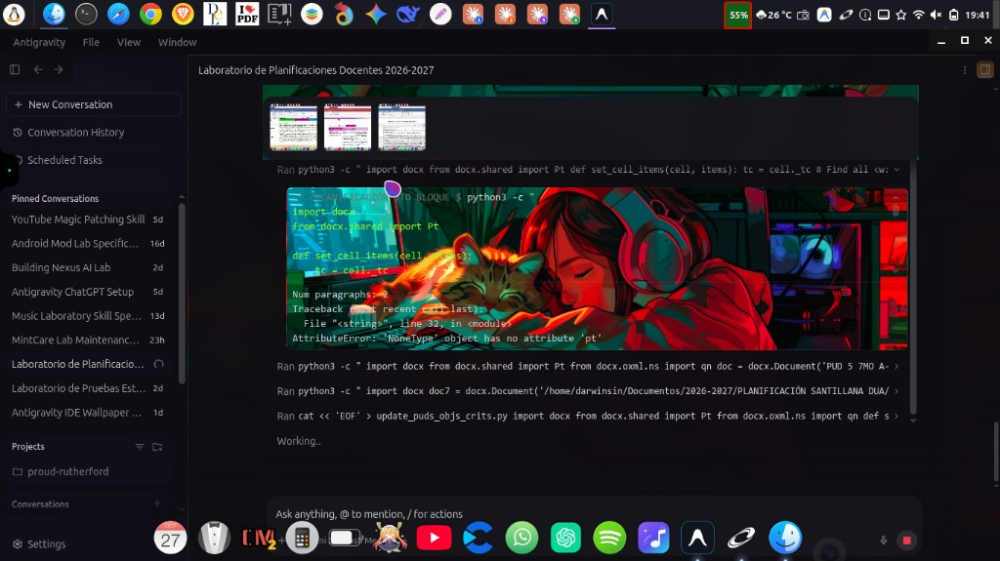

# 🌌 Antigravity Wallpaper Glassmorphism

[](https://archlinux.org/)
[](https://www.rust-lang.org/)
[](https://antigravity.google)
[](LICENSE)

> **Motor nativo en Rust para personalización de fondos y temas Glassmorphism en Google Antigravity 2.0 con soporte multi-distro (Debian, Ubuntu, Mint, Arch Linux / AUR) y arquitectura reactiva sin I/O bloqueante.**

<div align="center">
  
</div>

---

## 📖 Descripción General

**Google Antigravity 2.0** es un entorno de desarrollo asistido por IA basado en Electron. Por defecto, su interfaz posee un fondo oscuro sólido `#101010` y carece de soporte oficial para wallpapers personalizados.

Este proyecto provee una solución técnica integral mediante **`agy-glass`**, un motor nativo en **Rust**:
1. Utiliza tus propios **wallpapers locales** (JPG, PNG, WebP) directamente en la interfaz.
2. Aplica **Glassmorphism translúcido** con desenfoque adaptativo (`backdrop-filter: blur()`).
3. **Capa Scrim inteligente:** Añade un filtro de contraste configurable que garantiza legibilidad 100% nítida de código y menús en fondos oscuros o claros.
4. **Cero I/O en Renderizado (0% Disk I/O):** A diferencia de inyecciones ingenuas que leen disco en cada mutación del DOM, `agy-glass` mantiene los estilos en memoria RAM y observa cambios de archivo de forma asíncrona (`fs.watchFile`).
5. **Detección Multi-Distro Nativa:** Soporte out-of-the-box para **Debian, Ubuntu, Linux Mint** y **Arch Linux / Manjaro** (AUR: `antigravity-bin`, `agy-cli`).

---

## 🚀 Instalación y Uso Rápido (Motor Nativo Rust)

### 1. Clonar y Compilar
```bash
git clone https://github.com/darwinsin822/antigravity-wallpaper-glassmorphism.git
cd antigravity-wallpaper-glassmorphism
cargo build --release
```
El ejecutable binario resultante estará disponible en `./target/release/agy-glass`.

### 2. Diagnóstico del Entorno (`doctor`)
Verifica automáticamente la detección de Antigravity en tu distribución y el estado del entorno:
```bash
./target/release/agy-glass doctor
```

### 3. Parchear Antigravity IDE (Operación Segura de 1 sola vez)
El motor crea una copia de seguridad verificada criptográficamente con **SHA-256** antes de aplicar la inyección reactiva:
```bash
./target/release/agy-glass patch
```
*(Si tienes una instalación personalizada, puedes pasar la ruta explícita: `./target/release/agy-glass patch --asar "/ruta/a/resources/app.asar"`)*.

### 4. Aplicar Wallpaper Local
Puedes pasarle cualquier imagen de tu sistema (la imagen original nunca se altera; se optimiza en memoria a stream JPEG 93%):
```bash
./target/release/agy-glass apply ~/Pictures/mi_wallpaper.jpg
```

Opciones de personalización:
```bash
# Ajustar opacidad de fondo, intensidad de blur y contraste scrim
./target/release/agy-glass apply mi_fondo.jpg --opacity 0.60 --blur 14 --scrim 0.50
```

Para listar los wallpapers detectados en tus carpetas XDG (`~/Pictures`, etc.):
```bash
./target/release/agy-glass list
```

### 5. Restauración Segura al Estado de Fábrica
Si deseas revertir cualquier cambio y regresar al estado original verificado:
```bash
./target/release/agy-glass restore
```
*Si la verificación de integridad SHA-256 no coincide exactamente con el registro original, la operación se cancela automáticamente para prevenir corrupción.*

---

## 🐧 Matriz de Compatibilidad Multi-Distro

| Familia de Distribución | Paquetes / Rutas Soportadas |
|---|---|
| **Debian / Ubuntu / Linux Mint** | `/opt/Antigravity`, `/usr/lib/antigravity`, `/usr/share/antigravity`, `~/.local/share/antigravity`, `~/Documentos/Antigravity-x64` |
| **Arch Linux / Manjaro / EndeavourOS** | AUR `antigravity-bin`, `agy-cli` (`/opt/antigravity-bin`, `/opt/antigravity`, `/usr/lib/antigravity`) |
| **Cualquier distribución Linux** | Detección automática por `$PATH` (`which antigravity`, `which agy`) o variable `AGY_ASAR_PATH` |

---

## 🏛️ Arquitectura Reactiva (Cero Disk I/O en DOM)

A diferencia de VS Code, la interfaz de Antigravity es una SPA reactiva que monta capas opacas (`.bg-background`).

El motor implementa un ciclo reactivo no invasivo:
```
┌─────────────────────────────────────────────────────────────┐
│                 MOTOR NATIVO AGY-GLASS (RUST)               │
├─────────────────────────────────────────────────────────────┤
│  1. Inyección de Preload Reactivo en app.asar               │
│  2. Caché de Estilos en RAM (Zero Disk Reads en eventos)    │
│  3. fs.watchFile Asíncrono (Detección de cambios de imagen) │
│  4. MutationObserver Ligero (Solo reancla nodo si es borrado)│
│  5. Capa Scrim (--agy-wallpaper-scrim) para contraste total │
└─────────────────────────────────────────────────────────────┘
```

---

## 📁 Estructura del Repositorio

```text
antigravity-wallpaper-glassmorphism/
├── Cargo.toml                  # Workspace de Rust (Edición 2021)
├── AGENTS.md                   # Directrices y contratos de ingeniería para Agentes
├── README.md                   # Documentación principal
├── LICENSE                     # Licencia MIT
├── crates/
│   ├── agy-glass-core/         # Biblioteca Rust (paths, sha256, imágenes, css, patcher)
│   └── agy-glass-cli/          # Binario ejecutable CLI (agy-glass)
├── styles/
│   ├── template.css            # Plantilla CSS con selectores documentados
│   └── active_sample.css       # Hoja de estilos de muestra para pruebas
├── legacy/python/              # Scripts originales de Python preservados
└── docs/                       # Especificaciones arquitectónicas detalladas
```

---

## 👥 Maintainers & Contributors

* **DarwinSin** ([@darwinsin822](https://github.com/darwinsin822)) — Conceptualización original, diseño visual Glassmorphism & análisis del DOM.
* **Kineyo** ([@Kineyo](https://github.com/Kineyo)) — Arquitectura del motor nativo en Rust (`agy-glass`), seguridad y optimización de runtime multi-distro.

---

## 📄 Licencia

Este proyecto está licenciado bajo la Licencia [MIT](LICENSE).
